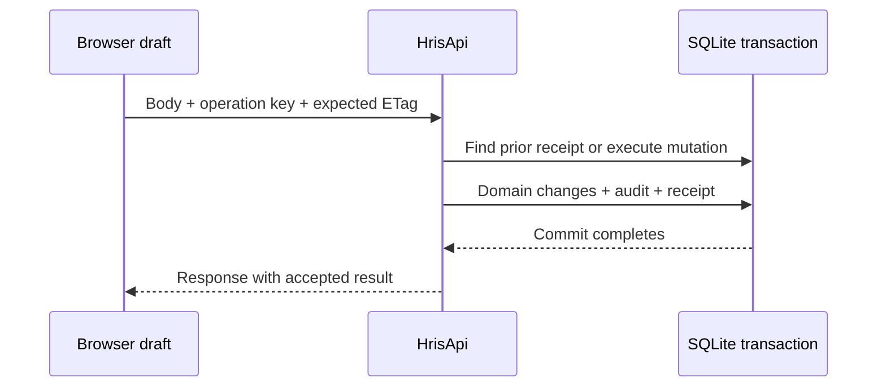

# Follow one write through its durability boundary

The client captures an operation object containing path, method, serialized body, key and optional ETag. [workshopApi.ts](../../client/src/workshopApi.ts) serializes the body once when creating that operation. Retrying the same object preserves the request's meaning. Building a new object after editing fields is a new operation, even if a button is still labeled Retry.

## Ordinary update

Assume department D is version 3. A learner edits its cost center and sends a valid strong ETag for D/3 with a fresh UUID operation key. `MutationTarget.From` obtains the expected version. `SaveDepartment` checks authorization, validates the name, compares versions and validates relationships. Domain changes are saved within the transaction opened by the request path. `Mutate` then records audit and receipt data and commits before sending the response.

Trace the existing code rather than assuming that each `SaveChangesAsync` is an independent committed transaction. Here several saves can participate in the same explicit transaction. A later failure before commit should roll back the earlier domain save; verifying that requires inspecting the resulting database.

## Stale update

Client A and client B both read D/3. A's accepted update advances the record. B still submits the ETag captured when editing began. The current implementation returns a conflict for a stale version. It uses **409** for this case, while an update without the required `If-Match` returns **428**. Do not substitute status codes remembered from another API without checking this project's contract and [scenario tests](../../tests/Nethris.Tests/ApiScenarioTests.cs).

The browser preserves B's draft and loads the latest record for comparison. Choosing to keep that draft against the latest version is explicit. A failed stale write should not create a success receipt or audit entry. Its useful artifact is the unresolved draft plus a clear next decision.

## Response lost after commit

The server may commit successfully and then lose the response. From the browser's network error alone, the outcome is uncertain. An exact retry with the same key and matching fingerprint finds the stored receipt and returns the original result. It does not execute the domain mutation again.

The fingerprint covers method, path, query, `If-Match` and body. A changed body or expected version changes the fingerprint. The receipt key is scoped to the authenticated account, and receipts have a bounded lifetime. Those details matter: “same key” is not a universal permanent deduplication guarantee.

## Replay is still a protected request

Authentication and current authorization remain part of the request path. The mutation code also rechecks visibility/authority for stored PTO decisions. A receipt is a way to recover a result under the defined contract, not a bypass around current access control.

Complete the [worksheet](labs/README.md) by predicting domain-write counts for first execution, exact retry and changed-body reuse. Then locate the receipt lookup and commit in source. The worksheet intentionally does not claim to execute SQLite.
